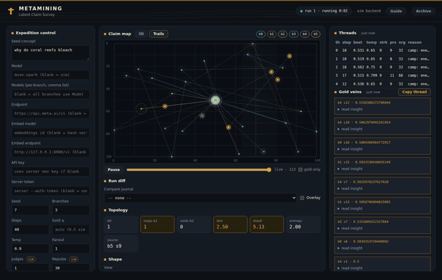
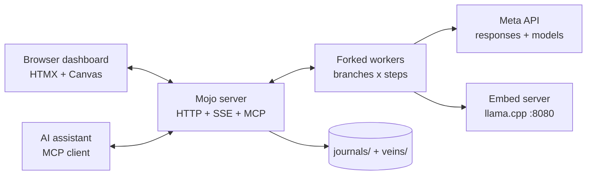
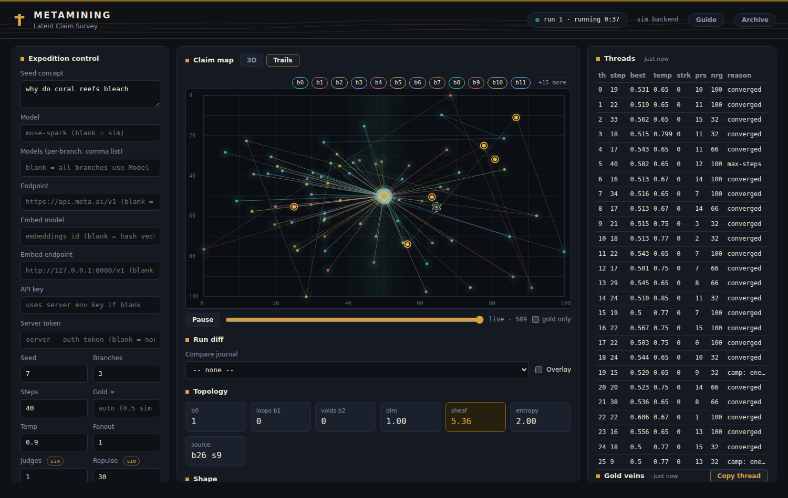
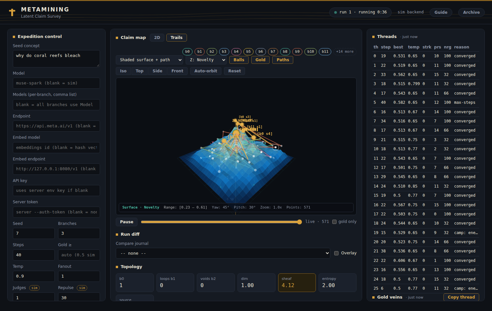

# MetaMining — pure-Mojo latent space explorer

[](https://github.com/JohnnyOpcode/MetaMining/actions/workflows/gate.yml)
[](LICENSE)
[](CHANGELOG.md)


MetaMining sends a crew of expedition workers into an LLM's latent space,
scores every finding for novelty × coherence, and plots the dig live on a
claim map. Its math engine (KDE novelty, lexical entropy, vector
steering, Vietoris-Rips topology) runs as a parallel multi-branch
expedition behind an HTMX dashboard.

- **Pure Mojo**: HTTP server, JSON, TLS 1.3 client, PCA, topology,
  steering, explorer math — all Mojo. Only libc and the system OpenSSL
  are touched, via Mojo FFI.
- **Meta models**: points at `https://api.meta.ai/v1` (Responses API)
  with a Bearer [REDACTED] `/v1/responses`, `/v1/models`, `/v1/embeddings` supported.
  Without a key it runs a deterministic sim backend (seeded templates +
  hash-BOW vectors) so the whole UI works offline.
- **Driven by assistants**: the server is an MCP endpoint (Streamable
  HTTP, 11 tools) — Claude Code can start expeditions, poll status, and
  pull topology while you watch the map. See
  [docs/mcp.md](docs/mcp.md).
- **Under every rock**: each branch runs the full expedition loop
  independently — persona lenses, seed chaining, repulsion, LLM judge,
  warp-to-frontier backtrack; plateau, dry, incoherent, and weeds detectors stop
  threads that get stuck, plus a global-weeds stop when the whole
  expedition stalls.
- **Hive 10x**: branches share a global memory (novelty is scored against
  the whole hive, not just one journal), the coordinator spawns
  vein-miners at gold strikes and respawns cold branches, workers lock
  onto veins by cooling down, and the map renders in 2D or 3D with
  trails, density heat, time scrubbing, and branch filters.
- **Shape views**: six topological surfaces over the surveyed ground —
  merge tree + basins, persistence barcode + Betti curves with
  resampling confidence, loop members + void, density + contours, Mapper
  graph, run timeline — with 2D/3D overlays, close-loop actions
  (teleport, corroborate, probe-next), and one-click research export
  (bundle JSON, CSV, PNG/SVG, methods paragraph).



## Docs

- [docs/concept.md](docs/concept.md) — the big idea: what MetaMining is,
  how it relates to quality-diversity / MAP-Elites / automated science, and
  its honest limits.
- [docs/quickstart.md](docs/quickstart.md) — first dig in 5 minutes:
  sim run, live run, and the gotchas that bite newbies.
- [docs/tutorial.md](docs/tutorial.md) — worked example with real numbers
  over the shipped benchmarks in `data/benchmarks/`.
- [docs/manual.md](docs/manual.md) — the detailed user manual: every panel,
  control, stop reason, cost rule, and troubleshooting step.
- [docs/topology.md](docs/topology.md) — the shape math: why topology,
  every invariant and surface, exact endpoint schemas, honest limits.
- [docs/research.md](docs/research.md) — eight research use-cases as
  runnable protocols, plus a methods checklist for papers.
- [docs/demo-script.md](docs/demo-script.md) — narrated 7-minute video
  tour, scene by scene with recording tips.
- [docs/mcp.md](docs/mcp.md) — MCP server interface: setup, tool
  reference, guided examples, protocol and errors.
- [docs/dev-setup.md](docs/dev-setup.md) — contributor setup: toolchain,
  build, test gate, scripts, and repo layout.

## Architecture



## Quickstart

Zero toolchain — Docker:

```bash
docker build -t metamining .
docker run --rm -p 8000:8000 metamining   # open http://127.0.0.1:8000
docker compose up --build                 # full stack + local embeddings
```

Native (needs the [Mojo toolchain](docs/dev-setup.md), one time):

```bash
./metamining.sh            # start everything: embed server + MetaMining on :8000
./metamining.sh stop       # stop both servers
./run.sh --concept "lattice memory" --branches 8 --steps 60   # foreground, sim
./run.sh --endpoint https://api.meta.ai/v1 --model muse-spark-1.3   # needs META_API_KEY
```

Open [http://127.0.0.1:8000](http://127.0.0.1:8000) in a browser: pick the
model, seed, and run parameters, press **Start expedition**, and watch the
claim map fill in. Findings stream over SSE; panels refresh via HTMX.
While a run is live you can pause/resume, force a warp, teleport to a new
front, switch persona lenses, and tune temp/gold/push sliders — all as
orders to the running workers.

## Feature tour

Everything below runs in the free sim backend (no key) unless marked live.

**Expeditions.** Each branch is an independent explorer with a persona
lens, seed chain, temperature ladder, repulsion, and an LLM judge.
Plateau, dry, incoherent, weeds, converged, and budget detectors stop
stuck threads; a global-weeds stop ends the run when the whole hive
stalls. Fanout samples up to 8 candidates per step and pursues the top
routes (beam search, not best-of-N discard).

**Scoring.** Every finding gets novelty (KDE + lexical + topological
blend), coherence [1,10] with judge votes, and gold status
(auto-thresholded: 0.5 sim / 0.8 live). The Pareto frontier keeps the
non-dominated claims; veins immortalize gold strikes across runs.

**The hive.** Branches share memory every 4th step (novelty is scored
against the whole hive), gold strikes spawn vein-miner branches, cold
branches respawn fresh, and gold cools a branch onto its vein. The run
queue chains follow-up concepts with per-item config snapshots.

**The map.** PCA claim map in 2D or 3D (surface, wireframe, manifold,
scatter), with branch trails, KDE density heat, time scrubber + replay,
gold-only mode, branch filters, hover tooltips, and run-diff overlay of
any saved journal. Five Z-axis metrics: novelty, PCA-Z, cohom dim,
coherence, density.





**Topology radar + Betti strip.** Live b0/b1/b2 (components, loops,
voids), complexity index, trajectory curvature, and persistence entropy
per finding — plus a history strip plotting all three Betti numbers as
the run unfolds.

**Shape laboratory.** Six on-demand topological surfaces (see below),
each with refresh/stale/live semantics, plain-language captions, and
screen-reader data tables.

**Close the loop.** Shape drives action: teleport any branch to a basin
peak, one-click corroborate a peak from spread persona lenses, and
probe-next suggestions (void chamber or sparsest gap, marked `P?`).

**Research export.** One click downloads the bundle JSON (manifest +
journal + state + all six surfaces), findings CSV, map/shape PNG,
vector SVG, or a pre-filled methods paragraph for papers.

**Provenance.** Journals and veins self-describe model, endpoint,
embed_model, embed_endpoint, vec_kind, and app version; vecs persist and
reload (legacy hash journals recompute from text), so shape views work on
archived runs. Shipped `data/benchmarks/` give reproducible reference runs.

## Shape laboratory (the six views)

| View | Shows | Signature move |
|---|---|---|
| Merge tree | novelty peaks joining downward; basins = which hill each point drains to | Basin tint + Teleport here / Corroborate peak |
| Barcode + Betti | persistence bars (H0/H1/H2) + b-vs-scale curves over vec distance | cosine/euclid metric switch; Confidence bolds resampling-stable bars |
| Loops + void | repetition rings + unexplored chamber at median scale | overlays 2D map and 3D terrain |
| Density + contours | KDE heat + iso-contours (bandwidth 5) | Suggest probe marks `P?`; feeds Z: Density |
| Mapper graph | nerve over the novelty lens (bins/overlap adjustable live) | flares = exploration fronts |
| Timeline | b0/b1/b2 ribbons over run deciles | loops forming vs voids closing at a glance |

Map-space views line up with the map point-for-point; vec-space views
(barcode, timeline) show the deeper geometry. When they disagree, suspect
a PCA fold — rotate the 3D view to check. Full theory, endpoint schemas,
and limits: [docs/topology.md](docs/topology.md).

## Research use-cases

Eight runnable protocols in [docs/research.md](docs/research.md):
knowledge-frontier cartography, self-consistency corroboration, red-team
strategy archives, idea discovery for science, model comparison,
novelty-metric research, knowledge probing, and classroom demos — each
with steps, outputs, reporting checklists, and limits.

## Demo script

A ready-made ~7-minute narrated tour lives in
[docs/demo-script.md](docs/demo-script.md) — six timestamped scenes from
first Start to research export, written to record directly.

## Tests

```bash
./test.sh             # 13 unit suites + loopback end-to-end self-test
./bin/metamining --self-test   # E2E only, against the built binary
META_OFFLINE=1 ./test.sh       # skip the live-TLS handshake probe
```

Live Meta calls run only when `META_API_KEY` (or `MODEL_API_KEY`) is set;
`META_EMBED_MODEL` enables the live embeddings probe. Extractors and
framing are covered offline regardless.

## Layout

```
src/main.mojo            CLI, run loop, loopback E2E self-test
src/metamining/
  libc.mojo              sockets, pipes, fork/exec-free process control
  tls.mojo               TLS 1.3 client (system libssl), CONNECT proxies, DNS
  http.mojo              HTTP/1.1 parse/build, blocking client, static files
  json.mojo              arena JSON parser + renderer
  linalg.mojo            vec ops, power-iteration PCA, rank/nullspace
  topo.mojo              Vietoris-Rips, exact Betti, persistence, curvature
  scoring.mojo           KDE + lexical + topological novelty, coherence, gold
  steering.mojo          ortho projection, topo push, momentum, contrast cues
  sim.mojo               deterministic sim backend (templates + hash-BOW-64)
  explorer.mojo          branch state, Pareto picks, weeds stops, wire JSON
  endpoint.mojo          Meta client (/v1/responses, /v1/models, /v1/embeddings)
  worker.mojo            expedition loop (one forked worker per branch)
  server.mojo            coordinator: PCA map, orders, routes, SSE fan-out
web/                     HTMX dashboard (index.html, app.css, app.js, htmx.min.js)
tests/test_*.mojo        maintained suites, one per module (sim is
                         covered by test_explorer, server by the
                         self-test E2E: no test_sim/test_server;
                         test_web cross-checks controls/routes)
docs/                    concept, quickstart, tutorial, manual,
                         topology, research
data/benchmarks/         seeded reference journals + README signatures
CITATION.cff             citation metadata (AGPL-3.0-only)
CHANGELOG.md             Keep-a-Changelog release history
```

## HTTP surface

- `POST /mcp` — MCP server (Streamable HTTP, 11 tools: expeditions,
  findings, search, topology, journals, models; see manual §16 and
  [docs/mcp.md](docs/mcp.md) for the full interface + guided examples)
- `GET /` `/app.css` `/app.js` `/htmx.min.js` — dashboard assets
- `GET /api/state` — run, config (never the key), workers + telemetry, topo,
  `api` totals (Responses calls/ms, embed calls/ms, billed tokens in/out)
- `GET /api/findings?since=N&gold=0|1&limit=K` — findings window (PCA x/y/z,
  topo b0/b1/b2/cd, persona, temp, loc, src). The live view keeps the
  newest 8000 findings; `next` stays an absolute total and stale
  `since` values clamp to the oldest retained row.
- `GET /api/journal` — expedition journal: entries + Pareto indices
- `GET /api/journals` — saved journals: filename, starting_concept,
  model, endpoint, step_count, size_kb, modified_time (mtime desc). The
  parsed listing is cached and revalidated by mtime/size each request.
  Saved files self-describe provenance at the root (model, endpoint,
  embed_model, embed_endpoint, vec_kind, app_version) and persist vecs,
  so shape views work after reload.
- `GET /api/step?branch=B&step=S` — one finding (same item shape as
  `/api/findings`); 400 on bad params, 404 when absent
- `POST /api/load_journal` — `{filename?, custom_json?, mode}`; replace
  swaps the live view, merge appends (src tags the origin file)
- `GET /api/models` — `{"t":"models","sim":bool,"models":[...]}`;
  `sim` is true when no endpoint is configured. Live refreshes are
  cached 60 s per endpoint+key.
- `GET /api/log` — recent expedition log lines
- `GET /api/veins` — vein-memory library (id/text/novelty/coherence/
  branch/step/run/src/created/model/endpoint, no vectors), persisted in
  `./veins/veins.json` with a root `meta.models[]` naming every
  contributing model@endpoint (writes debounced: at most every 30 s,
  plus always on run end, stop and explicit save)
- `GET /api/related?branch=B&step=S` — top-5 cosine-similar veins for one
  finding (self excluded); 404 when unknown
- `GET /api/queue` — run queue (`autoque` flag + items with
  queued|running|done status plus the enqueue-time snapshot:
  seed/gold/temp/repulse/fanout/judges/auto)
- `GET /api/search?q=..&limit=N` — hash-BOW cosine search over live
  findings + veins + 20 newest journals (cap 50; lexical overlap only,
  not semantic)
- `GET /api/tree` — branch genealogy nodes (bid/parent/kind
  seed|gold|respawn/step)
- `GET /api/topo_merge|topo_bars|topo_conf|topo_loops|topo_mapper|topo_time` —
  shape surfaces (merge tree, barcode + curves, resampling confidence,
  loops + void, Mapper nerve, run timeline); exact schemas in
  `docs/topology.md` §5
- `GET /api/journal_file?name=<basename>` — read-only journal entries;
  `journal_*.json` basenames only, rejects `/` and `..` names
- `GET /events` — SSE: `finding` / `state` / `log` messages
- `GET /frag/threads|gold|stats` — HTMX fragments
- `POST /api/control` — JSON or form-encoded. Actions:
  `start` (concept/model/models/fanout/judges/auto/endpoint/embed_model/
  embed_endpoint/embed_doc_prefix/embed_query_prefix/
  api_key/seed/branches/steps/gold/temp/repulse/push/call_budget/
  plateau_k/plateau_eps/nogold_m/min_coh/coh_c/global_stall), `stop`,
  `pause`, `resume`, `warp`, `restart`, `teleport` (target), `persona`
  (idx 0-15), `tune` (temp/gold/push/repulse 0-40, 0 = off, fanout 1-8,
  judges 1-5, call_budget), `autopop` (enabled 0/1), `setmodel` (bid, model),
  `auto` (enabled 0/1), `enqueue` (concept/model?/branches?/steps?/
  seed?/gold?/temp?/repulse?/fanout?/judges?/auto? — unset fields
  snapshot the current config; 400 past 100 queued items),
  `autoque` (enabled 0/1), `clearqueue`,
  `save` (writes `./journals/journal_STAMP.json`, auto-saves at
  completion/stop too); warp/teleport/persona/tune/auto accept an
  optional `bid` to target one branch (`setmodel` requires it). Tune
  applies only the keys present, and stores temp/gold/push plus
  repulse/fanout/judges (auto stores its flag) in the global config
  too, so later starts inherit them. start/stop/save
  and the queue actions ignore `bid`. Manual `stop` always leaves
  the server idle (queued items stay queued); the queue advances
  only on natural completion. `restart` reforks dead branches back
  to the full complement (it also works after completion) and
  rebuilds the tree fresh, while queue advance preserves the tree;
  `setmodel` switches persist across restarts.

Worker ↔ coordinator wire adds `vec` (finding vectors for the PCA map)
and `tele` (temp/streak/persona/energy/Betti/sheaf/entropy/judges plus
per-worker Responses calls/ms, embed calls/ms, tokens in/out, push) lines
upstream, and `order` lines downstream (`memory` carries the hive
archive: others' texts, a vector sample, and the gold mean).

The dashboard's API panel (calls, avg flight ms, completion tok/s,
billed in/out tokens, embed calls) is fed by SSE `state` broadcasts on
every telemetry tick plus a 15 s backfill refresh. In sim mode the
generators bypass the metered Responses wrapper (calls/tokens read
zero), but every hash embed is counted, so the embed cell stays
honest.
Reasoning models sometimes burn the whole output budget on the thinking
trace and return HTTP 200 with no text; `meta_respond` retries those
in-call (up to 3 tries, ms/tokens summed across attempts) instead of
failing the step. Transport errors and 429/5xx responses retry the
same way (1 s / 2 s backoff); 401/403 and other 4xx fail fast.
`call_budget` (0 = unlimited) caps metered Responses + embed calls
per worker; the run stops with reason `budget` when it is hit. After
3 consecutive embed failures a worker falls back to sim hash-BOW-64
vectors and notes it in the feed.
On the start form, blank fields are omitted so every value keeps the
server default; over JSON, blank model/endpoint/embed_model wipe to
empty (blank endpoint, model, or key selects the sim backend), while
blank concept/key/numerics keep the server's values.

## Hive exploration (the 10x)

Single-threaded explorers run one line of inquiry; MetaMining runs a hive:

- **Shared memory**: every 4th step each branch receives the hive
  archive — sibling texts, a 20-vector sample, the gold mean. KDE and
  lexical novelty take the min of own-journal and hive scores, so a
  branch can't strike gold on terrain a sibling already mined. Repulsion
  and momentum blend hive words and the hive gold direction too.
- **Population manager** (toggle: Auto-population): a gold strike spawns
  a vein-miner branch seeded at the strike text; a branch stuck below
  0.45 best after 12 steps is retired and respawned fresh with a new
  seed. Spawn/respawn/memory counters live in Run stats.
- **Vein lock**: gold cools a branch (extra −0.10 temp) so it digs the
  vein instead of wandering off; the temp ladder still heats up dry
  branches. Branches start spread across persona lenses.
- **3D claim map**: PCA now fits 3 components; the map toggles 2D/3D
  (drag to rotate, double-click to reset), with branch trails, a KDE
  density heat field, a time scrubber with replay, clickable branch
  filters, gold-only mode, and hover tooltips. Gold veins expand inline;
  the whole journal (entries + Pareto frontier) downloads as JSON.

## Advanced expedition features

- **Vein memory**: every gold strike is appended to `./veins/veins.json`
  (cap 1000, auto-loaded at startup); workers are repelled from mined
  veins (novelty halved past 0.97 cosine) and drift toward the nearest
  one. Related veins surface in the finding modal.
- **Run queue**: enqueue follow-up concepts; with auto-start on, the
  next run begins when one completes naturally (queued → running →
  done) — a manual stop always idles instead. Each item snapshots
  the run config at enqueue time and carries it into its run.
- **Search**: one box over live findings, vein memory, and saved
  journals, ranked by hash-BOW cosine (lexical overlap, not semantic).
- **Per-branch models**: comma list on the start form (branch i takes
  entry i % len, wrapping around; blank entries fall back to the run
  default); `setmodel` switches one branch live.
- **Fanout**: sample N candidates per step (1-8), keep the best
  novelty × coherence; every candidate is a metered call.
- **Auto-tune**: epsilon-greedy bandit nudges temp/push every 4th step
  on trailing novelty; toggleable live, per-thread chips in the UI.
- **Judges**: N votes per step (1-5), median blended into coherence;
  vote counts accumulate in telemetry.
- **Genealogy**: seed/gold-spawn/respawn nodes trace every branch's
  origin in the tree panel.
- **Journal read API**: any saved journal renders read-only for the
  run-diff overlay (`journal_*.json` basename only; traversal rejected).
- **Converged stop**: a branch whose novelty goes stationary (trailing
  means within 0.02, flat slope, 16+ samples) stops as `converged`.
- **Shape close-loop**: basin teleport, one-click corroborate (spread
  persona lenses), probe-next suggestions, Betti history strip, run
  timeline, barcode confidence, cosine/euclid metrics.
- **Research export**: bundle JSON, findings CSV, map/shape PNG, shape
  SVG, pre-filled methods paragraph; versioned, citable, benchmarked.

## Math engine map

| Component | Module | Notes |
|---|---|---|
| KDE novelty (τ=0.20, γ=0.97) | `scoring.kde_novelty` | history cap 150 |
| lexical entropy + 0.60/0.25/0.15 composite | `scoring.lexical_novelty`, `composite_novelty` | — |
| coherence [1,10] + judge blend + gold rule | `scoring.coherence_base`, `blend_judge`, `is_gold` | judge on nov ≥ gold bar |
| vector steering (all six methods) | `steering.mojo` | incl. push 0.90/0.25 |
| Vietoris-Rips topology | `topo.mojo` | VR + exact Betti + persistence; window N=24, median scale |
| merge tree + Mapper + timeline | `topo.mojo` | join tree + basins, nerve over novelty lens, decile Betti |
| resampling confidence | `server.mojo` topo_conf | 8 deterministic folds, 5% match tolerance |
| expedition loop | `worker.mojo` | per branch: personas, seeds, warp, camp, temp ladder |
| dashboard commands | `/api/control` orders | pause/resume/warp/restart/teleport/persona/tune |

Implementation notes (all documented at the module site): repulsion is
prompt-level (no sampler access over HTTPS); brevity by instruction (the
Responses shape caps output with max_output_tokens, sent as 4096);
contrast-themes journal/log indexing is aligned; per-branch stops and
the sim backend are built in.

## Notes

- Mojo 1.2 ships no public threads/`parallelize`, so expedition "threads"
  are forked worker processes today (true OS parallelism, shared-nothing,
  pipes back to the coordinator). The worker loop is one function and can
  move in-process if the stdlib regains threads.
- TLS verifies chain + hostname (SNI) against the system CA store, and
  honors `HTTPS_PROXY` via CONNECT tunnels. The handshake is covered by a
  live test against api.meta.ai (expects 401 without a key).
- Stop reasons: `max-steps`, `plateau`, `dry`, `incoherent`, `weeds`,
  `converged`, `budget`, `backend-error`, `respawned` (per thread) and
  `global-weeds`, `stopped`, `shutdown`, `complete` (whole run), all
  visible in the UI. When every worker is dead the run-level reason is
  the dominant worker reason (first-seen wins ties).
- Dashboard rendering is byte-verified (200s, markers, fragments) and
  exercised in headless Chromium via Playwright: form starts, veins /
  queue / search / tree panels, setmodel + auto toggles, run-diff
  overlay, and a full queue auto-advance — zero console errors.

## Version

`./bin/metamining --version` prints the release (`0.9.0`). The version
also ships in `/api/state`, every research-bundle manifest, and every
saved journal/veins head, so published artifacts always name the build
that produced them.

## Citation

If MetaMining contributes to published work, cite it via
[CITATION.cff](CITATION.cff) and archive the research-bundle JSON
(Shape panel → Export) with the paper — it contains the full protocol,
yield, shape surfaces, and spend.

## License

GNU Affero General Public License v3.0 only — see [LICENSE](LICENSE).
